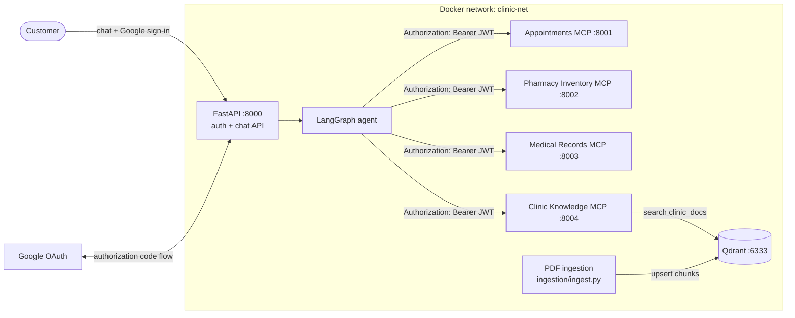

# Clinic Assistant v2 architecture (#314)

| Component | Port | Owner item | Holds secrets |
|---|---|---|---|
| FastAPI + Google OAuth + agent | 8000 | 6 | `GOOGLE_CLIENT_*`, `JWT_SECRET`, `OPENAI_API_KEY` |
| Appointments MCP | 8001 | 1 | `JWT_SECRET` |
| Pharmacy Inventory MCP | 8002 | 2 | `JWT_SECRET` |
| Medical Records MCP | 8003 | 3 | `JWT_SECRET` |
| Clinic Knowledge MCP | 8004 | 5 | `JWT_SECRET`, `OPENAI_API_KEY` (query embeddings) |
| PDF ingestion | script | 4 | `OPENAI_API_KEY` (embeddings) |
| Qdrant | 6333 | 7 | none |

## Who trusts whom

Google is the only party that vouches for who a person is: FastAPI trusts the
`sub` and `email` Google returns after the authorization-code exchange, and
turns them into a JWT (`sub`, `email`, `scopes`, `exp`, HS256, one hour). The MCP
servers never talk to Google or to the user. They trust a request only if its
Bearer token verifies against the shared `JWT_SECRET`, is not expired and carries
the scope the tool needs; then they use `sub` from the token, never an argument or
chat text, to pick the caller's data. The agent is not trusted with identity: it
forwards the token and cannot change its claims without breaking the signature.
All containers share one host and one network, so one secret is enough; domain
secrets (such as the OpenAI key) live only in the server that needs them.
