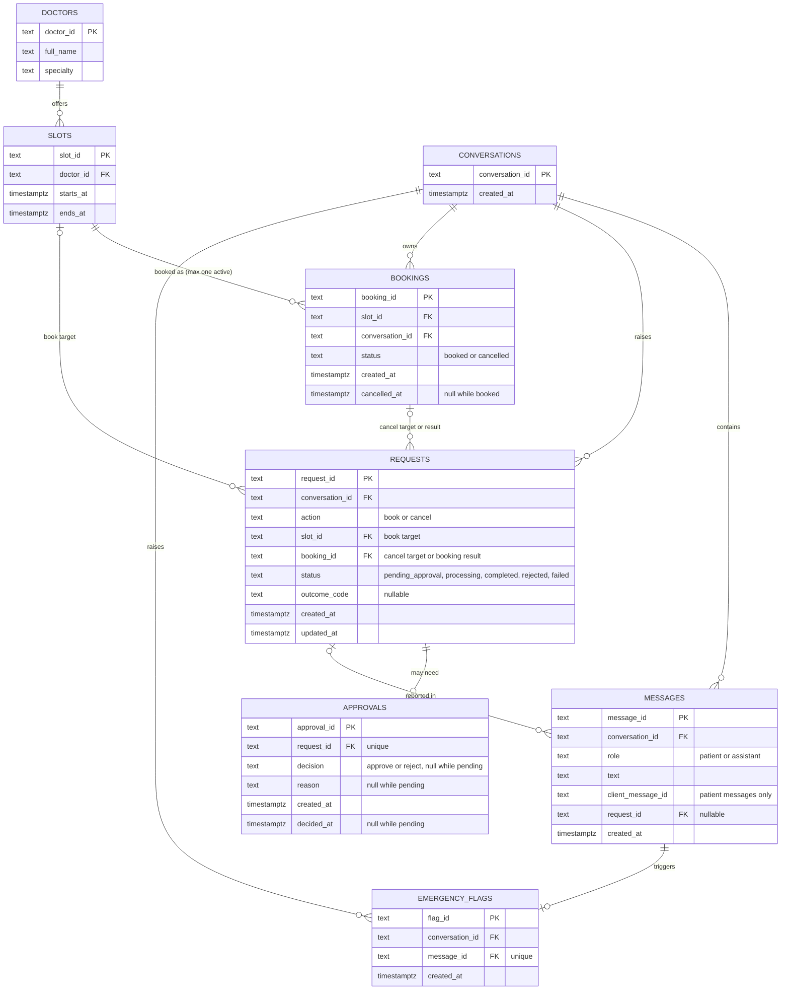

# Database diagram

Status: **Proposed, not yet reviewed by the team**. Issue: [#22](https://github.com/LaAaG21/clinic-assistant/issues/22).
Built on the proposed contract in [service-boundaries-and-api.md](service-boundaries-and-api.md) (#6). This is documentation only; SQL belongs to the coding issues (doctors and slots: #19).

The six entities required by #22 are doctors, slots, bookings, conversations, messages and approvals. `requests` and `emergency_flags` come from #6 (request resources and staff flags); including them is part of this proposal and needs team agreement.

## Entity-relationship diagram

## Keys and rules per table

All IDs are server-generated opaque text (#6). All times are `timestamptz`, so every value carries an absolute instant and the clinic timezone is applied only when a local date is needed (#6, #20).

| Table | Key and relationships | Proposed rules |
|---|---|---|
| `doctors` | PK `doctor_id` | `full_name` and `specialty` required and non-empty after trimming. |
| `slots` | PK `slot_id`; FK `doctor_id` → `doctors` (required) | `starts_at` and `ends_at` required; **`starts_at < ends_at`**; unique `(doctor_id, starts_at)`. A slot holds no booking state; availability = no active booking. |
| `bookings` | PK `booking_id`; FK `slot_id` → `slots`, FK `conversation_id` → `conversations` | `status` in (`booked`, `cancelled`). **Unique `slot_id` where `status = 'booked'`** (partial unique index): two active bookings for one slot are impossible even under concurrent requests, and a cancelled slot can be booked again. `cancelled_at` set exactly when cancelled. |
| `conversations` | PK `conversation_id` | Created by `POST /conversations`. |
| `messages` | PK `message_id`; FK `conversation_id`; optional FK `request_id` | `role` in (`patient`, `assistant`). Unique `(conversation_id, client_message_id)` for safe retries (#6); `client_message_id` required for patient messages, null for assistant messages. |
| `requests` | PK `request_id`; FK `conversation_id`; optional FKs `slot_id`, `booking_id` | `action = 'book'` requires `slot_id`; `action = 'cancel'` requires `booking_id`. A completed booking request points to the booking it created. Status values from #6. |
| `approvals` | PK `approval_id`; FK `request_id` **unique** (at most one approval per request) | Exists only for cancellations and same-day bookings. `decision`, `reason`, `decided_at` are all null (pending) or all set (decided): one decision only (#6). |
| `emergency_flags` | PK `flag_id`; FK `conversation_id`; FK `message_id` unique | One flag per emergency message. |

### Slot time-validity rules for #19

1. `starts_at` and `ends_at` are `timestamptz NOT NULL`; inputs without an explicit offset are rejected (#6: RFC 3339 with offset).
2. `CHECK (starts_at < ends_at)`.
3. `UNIQUE (doctor_id, starts_at)`: no duplicate slot for the same doctor and start.
4. FK `doctor_id` → `doctors.doctor_id`: a slot cannot point to a doctor who does not exist.

Bookings and the booking-conflict index are outside #19 (future bookings issue).

## Application tables vs LangGraph checkpoint tables

The [R1 experiment](../research/r1-postgres-checkpoints.md) (#3) showed that `PostgresSaver.setup()` creates and migrates its own tables in the same database: `checkpoints`, `checkpoint_blobs`, `checkpoint_writes` and `checkpoint_migrations`, keyed by `thread_id`. They are **not** in the diagram above on purpose.

| | Application tables (diagram above) | LangGraph checkpoint tables |
|---|---|---|
| Owner | This team: our SQL files and migrations | The `langgraph-checkpoint-postgres` library (`setup()` and its migrations) |
| Content | Business records: doctors, slots, bookings, requests, decisions, messages | Serialised graph state per step, for resume after a restart or interrupt |
| Read/written by | Our repositories, with plain parameterised SQL | Only the checkpointer API, never our SQL |
| Schema changes | Reviewed by the team | Can change when the library version changes |

Proposed rules:

1. No foreign keys from application tables into checkpoint tables, and no SQL that reads or edits them; the format belongs to the library.
2. Business facts that staff or patients rely on (pending approval, decision, outcome, booking) live in application tables, so they stay correct and queryable even if a checkpoint is replaced.
3. The only link is the thread identity: a conversation maps to one graph `thread_id`. Whether `thread_id = conversation_id` (R1 proposal) or a separate stored value is **not agreed** (see Q1).

## Walkthroughs

- **Booking:** patient message → `messages` row (`role = patient`) → `requests` row (`action = book`, `slot_id`). Not same-day: insert `bookings` (`status = booked`); the partial unique index rejects a second active booking for that slot; the request becomes `completed` with `booking_id`, and an assistant `messages` row carries the outcome.
- **Conversation with messages:** one `conversations` row, many `messages` ordered by `created_at`; a retry with the same `client_message_id` hits the unique key instead of creating a duplicate. Graph state for the same conversation is in the checkpoint tables under its `thread_id`.
- **Pending approval:** a cancellation creates a `requests` row (`action = cancel`, `booking_id`, `status = pending_approval`) and an `approvals` row with null decision; the graph pauses at its interrupt (checkpoint tables). Staff decide → `approvals` gets decision, reason and time → the graph resumes → the booking is cancelled (approve) or untouched (reject) → the request becomes `completed` or `rejected` and an assistant message reports it.

## Open questions (not agreed)

| # | Question | Depends on |
|---|---|---|
| Q1 | Is the graph `thread_id` equal to `conversation_id`, or stored as its own column? | #3, #4, #6 |
| Q2 | How does an approval find its paused graph run (thread only, or also an interrupt/checkpoint ID)? #4 has no findings yet. | #4 |
| Q3 | Source of truth when request status in our tables and the graph state disagree after a failure. | #4, #6 |
| Q4 | Checkpoint tables in the default schema or a separate schema; when `setup()` runs. | #3 |
| Q5 | Include `requests` and `emergency_flags` as proposed here? | Team |
| Q6 | Name: `bookings.booking_id` here vs `appointment_id` in the #6 API. Same value, different name? | #6 |
| Q7 | Specialty as text on `doctors` (here) or its own table? | Team |
| Q8 | Besides unique start time, must overlapping slots for one doctor be blocked (needs an exclusion constraint)? | #19 |
| Q9 | Where message citations are stored (column or table). | #5, #6 |
| Q10 | Retention of messages and checkpoints. | Team |

## Learning question

*Why should LangGraph-managed checkpoint tables be distinguished from application-owned tables?*
Because they have different owners and purposes. Our tables hold business facts under our own schema and rules; the checkpoint tables hold the library's serialised workflow state, whose structure can change with a library upgrade. Keeping them apart means we never depend on, or corrupt, an internal format we don't control, and staff-facing facts stay reliable on their own.

## Review status

The Mermaid source parsed and rendered without errors with Mermaid 11.4.1 (2026-11-02). Team review, actual agreement and answers to Q1–Q10 are still to be recorded here.
