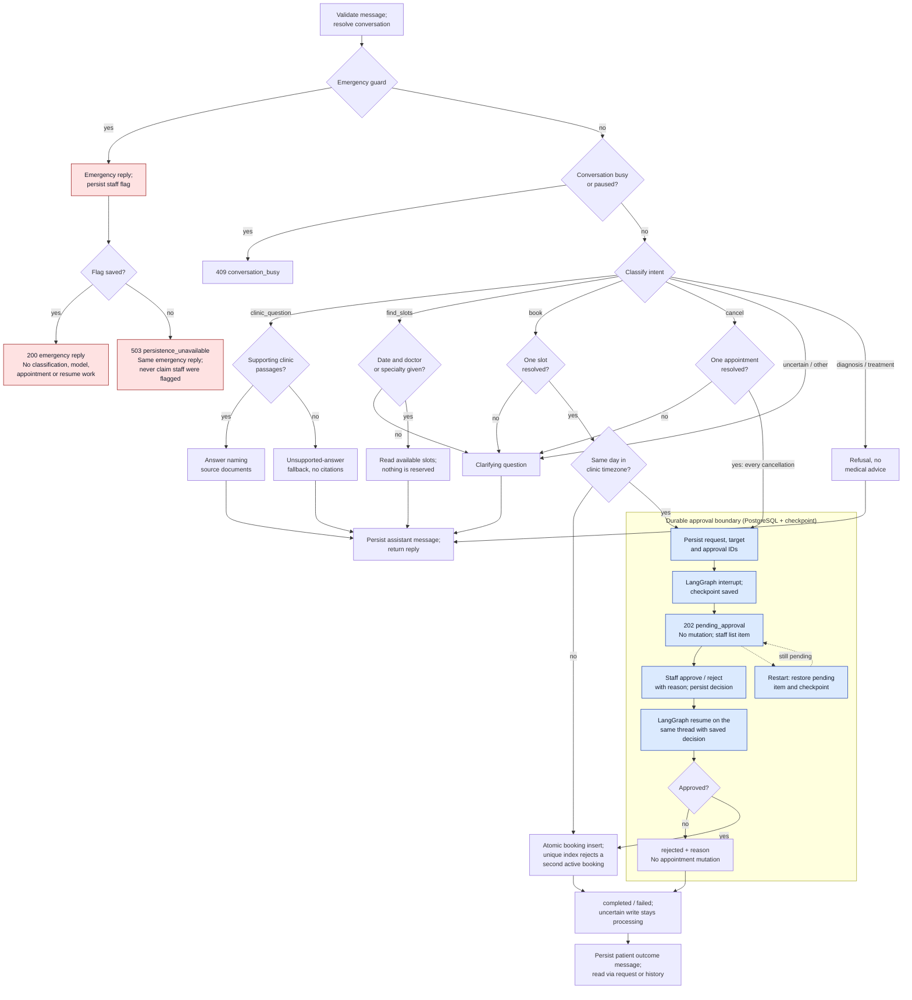

# Message and staff-approval workflow

Status: **Draft proposal for [#38](https://github.com/LaAaG21/clinic-assistant/issues/38);
team review and the research decisions listed below remain open.** Required
behavior comes from FR-1 through FR-6 in the
[Word brief](../requirements/clinic-front-desk-assistant.docx). Routes, response
states, retries and public IDs follow the proposed
[service boundaries and API contract](service-boundaries-and-api.md) (#6); tables
follow the proposed [database diagram](database-diagram.md) (#22). The diagram
describes the intended workflow. The graph itself is not implemented (#70) and
nothing here is end-to-end verified.

## Diagram

Solid arrows show normal control flow; dotted arrows show restart recovery.
Invalid input is rejected with the contract's 400/422 errors (#43) before the
diagram starts. Red nodes are the emergency path; blue nodes are the durable
approval boundary.

## How to read the diagram

**Emergency first.** The guard runs before the ordinary classifier, the busy
check and any paused graph, so a model delay or a pending appointment cannot hold
up the safety reply. The reply is returned with `intent: emergency` and
`response_type: emergency`, and a staff flag is persisted for `GET /staff/flags`.
If the flag cannot be saved, the contract's special `503 persistence_unavailable`
response still carries the emergency instruction and does not claim staff were
notified. An emergency during a pause uses this separate handoff; it must not
resume, replace or overwrite the pending action. Guard rules and wording still
need team review; the model's `emergency` label is not a substitute for the guard.

**Ordinary paths.** `classify_intent` (#63) returns one of `clinic_question`,
`find_slots`, `book`, `cancel` or `other` plus an `uncertain` flag and optional
details; `clarify` (#68) turns uncertainty or missing details into a question
without inventing IDs or dates. Clinic answers use only supporting passages and
name their sources; no support means the explicit "I do not know from the clinic
documents" fallback, never a guessed answer. A diagnosis or treatment request
receives a refusal regardless of its label (#73); retrieval must not be used to
evade that rule. Slot lookup reserves nothing. None of these paths mutates an
appointment.

**Same-day bookings and all cancellations wait for staff.** The same-day decision
uses [`is_same_day_booking`](../../src/clinic_assistant/booking_policy.py) (#20):
both aware instants are converted to the configured clinic timezone before their
dates are compared; a server-local or UTC date is not a substitute. Every
cancellation pauses. Approval is permission to attempt the action, not a reserved
slot or a guaranteed result: the resumed graph rechecks state and performs the
mutation once. Rejection records the reason and performs no appointment mutation.
The patient reads the final outcome through `GET /requests/{request_id}` or
`GET /conversations/{conversation_id}`; SMS and email are out of scope.

**Durable pending state, real pause and restart recovery.** `pending_approval`
may be acknowledged only after both the application rows (`requests`,
`approvals`) and a checkpointed LangGraph interrupt exist; a status flag alone is
not a pause. Staff decide through `GET /staff/approvals` and
`POST /staff/approvals/{approval_id}/decision`; the application resolves the public
approval to the request and its graph thread, persists the decision, then resumes
the same thread. After a restart the pending row and the checkpoint are restored
together and the original target is unchanged. The shared arrows do not establish
one database transaction: code before an interrupt may replay, so it must be pure
or idempotent; crashes between decision, mutation, checkpoint and outcome writes
need reconciliation; an uncertain write stays `processing` rather than a guessed
result or a blind second mutation. Exact duplicate decisions return the saved
state; conflicting ones return `409 decision_conflict`. Dependency failures follow
the API error contract, never the unsupported-answer branch.

## Where each step stands on `main`

| Diagram step | On `main` | Still open |
| --- | --- | --- |
| Validate message, error envelope | `messages.py` (#8), `errors.py` (#43) | Message endpoint and retry identity (#75) |
| Emergency guard and staff flag | Nothing yet | Guard and `emergency_flags` (#55), `GET /staff/flags` (#60) |
| Classify, clarify, refuse | `classification.py` (#63), `clarification.py` (#68) | Diagnosis/treatment refusal (#73), bounded model context (#81) |
| Clinic answer with sources | `documents.py` (#21), `passages.py` (#28), `retrieval.py` (#41), `model_adapter.py` (#46), `openai_adapter.py` (#53, #58) | Answer composition and the evidence-sufficiency rule |
| Slots and bookings | `doctors`, `slots` (#19), `bookings` with `bookings_one_active_per_slot` (#39), `booking_policy.py` (#20) | Slot query (#71), booking and cancellation operations (#61) |
| Requests, approvals, messages | `conversations` (#26, first portion) | `requests` (#52), `messages` (#26, second portion), `approvals` (#40), staff decision routes |
| LangGraph pause, resume, checkpoint | Research spikes only (#3, #4) | Production checkpointer (#51), graph and dispatcher (#70) |

## Evidence and open decisions

| Evidence | Unresolved mechanism or decision |
| --- | --- |
| [R1 checkpoint findings](../research/r1-postgres-checkpoints.md) (#3) report state restored after container replacement on the same thread; the recommendation is proposed, not agreed. | Saver mode and lifecycle, public ID to `thread_id` mapping (database diagram Q1), concurrent work on one conversation, checkpoint evolution and retention. |
| [Interrupt/resume findings](../research/004-staff-interrupt-resume.md) (#4) describe a PostgreSQL-backed interrupt with `thread_id`, `pending_id` and `interrupt_id`, and warn that code before `interrupt()` can run again. End-to-end execution is recorded as not yet observed. | Runtime evidence, durable decision-to-resume handoff, duplicate or replayed decisions, mutation/checkpoint reconciliation (Q2, Q3), and the emergency handoff while another request is paused. |
| [Retrieval comparison](../research/clinic-document-retrieval.md) (#5) shows source-preserving passages and deterministic fake answers and fallbacks on a small synthetic set; the ADR was withdrawn pending share-out. | Retrieval method, passage limits and versioning, evidence sufficiency and real-model reliability. |

No accepted ADR exists in [`docs/adr/`](../adr/README.md) and this diagram claims
no team agreement. Resolve the items above through the research share-out and
record accepted decisions there. The clinic timezone, the same-day boundary, the
busy rule, guard wording and approval expiry are review questions from #6.

## Walkthrough

Design checks against the contract, not executed tests.

| Scenario | Path and expected result |
| --- | --- |
| Emergency, including while a request is paused | Guard → emergency reply and persisted flag → `200`; flag save fails → `503 persistence_unavailable` with the same reply. No classification, retrieval, booking, cancellation or resume; the paused request stays paused. |
| Clinic question | Guard passes → not busy → `clinic_question` → supporting passages → answer naming sources; no support → explicit fallback with no citations. |
| Ordinary booking | `book` with one slot → not today in the clinic timezone → atomic insert → `completed` with `appointment_booked`, or `failed` with `slot_unavailable` if another booking won. |
| Pending same-day booking | `book` → today → request and approval rows → interrupt and checkpoint → `202 pending_approval`; restart restores the same pending target without mutation. |
| Approved cancellation | `cancel` with one appointment → pending → staff approve with reason → resume the same thread → recheck and cancel once → `completed` with `appointment_cancelled`; outcome message in the conversation. |
| Rejected cancellation | Same pause → staff reject with reason → resume → `rejected` with `request_rejected`; the appointment is unchanged. |
| Unclear, unsupported or medical input | Clarifying question, unsupported fallback or refusal; none mutates an appointment or reserves a slot. |

Rendering: the Mermaid source above was rendered in a browser with Mermaid 11
on 2026-11-05 and the emergency, clarification, booking, pause/restart, decision
and outcome arrows were checked against the contract. The workflow code is not
implemented or verified by this documentation change.

## Learning question

*Why must the emergency path run before ordinary message classification?*
Because the classifier is ordinary model work: it can be slow, unavailable or
wrong, and it is skipped entirely while a conversation is busy or paused. A
patient in danger must get the safety instruction and staff must be flagged
regardless of model latency, provider outages or a pending appointment, so the
guard is a deterministic check that runs first and never depends on the model.
