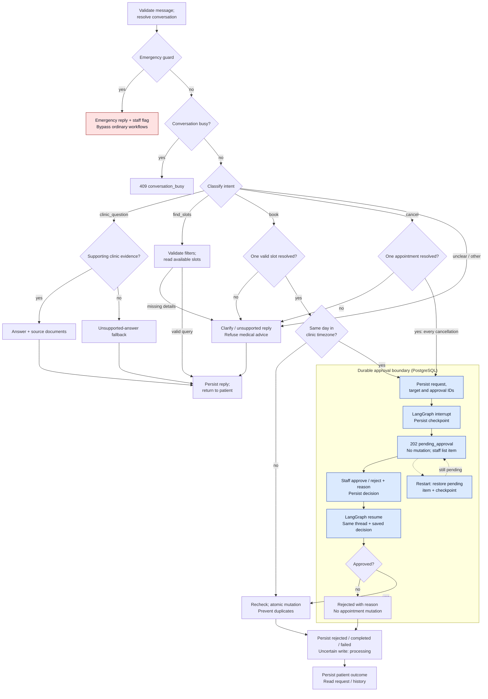

# Message and staff-approval workflow

**Draft proposal for #38; team review and research decisions remain open.**
Required behavior comes from FR-1 through FR-6 in the
[Word brief](../requirements/clinic-front-desk-assistant.docx). Routes, response
states, retries, and public IDs follow the current
[API contract](service-boundaries-and-api.md). This diagram describes the intended
workflow, not an implemented or end-to-end verified graph.

Solid arrows show normal control flow; dotted arrows show restart recovery.
The emergency guard runs before the ordinary classifier and busy check so a
model delay or paused appointment cannot hold up the safety reply. If saving the
staff flag fails, preserve the emergency instruction in the contract's special
503 response and do not claim staff were notified. Guard rules and wording still
need review. A diagnosis/treatment request must receive a refusal regardless of
its classifier label; document retrieval must not be used to evade that rule.
Invalid input follows the contract's 400/422 errors before entering this diagram.

The same-day decision uses [#20's helper](../../src/clinic_assistant/booking_policy.py):
convert both aware appointment and current timestamps to the configured clinic
timezone, then compare dates. A server-local or UTC date is not a substitute.
The clinic's actual timezone remains a configuration decision. Approval grants
permission to attempt a mutation, not a reserved slot or guaranteed success.

`pending_approval` requires both durable application records and a real
checkpointed LangGraph pause before acknowledging it to the patient. A status
flag alone is insufficient. Staff use `GET /staff/approvals` and
`POST /staff/approvals/{approval_id}/decision`; the application resolves the public
approval to the original request and internal thread, then resumes it. Rejection
preserves the appointment; approval rechecks state and performs the operation
idempotently. The patient reads
`GET /requests/{request_id}` or `GET /conversations/{conversation_id}`. A final
message belongs in the same conversation; SMS/email is outside scope.

The diagram's shared arrows do not establish a single database transaction.
Interrupt nodes may replay, so code before the interrupt must be pure or
idempotent. Crashes between decision, mutation, checkpoint, and outcome writes
require reconciliation. Exact duplicate decisions return the saved state;
conflicting decisions return 409. An uncertain write remains `processing`, never
a guessed success/failure or blind second mutation. Dependency failures follow
the API error contract, not the unsupported-answer branch.

## Evidence and open decisions

| Evidence | Unresolved mechanism or decision |
| --- | --- |
| [R1 checkpoint findings](../research/r1-postgres-checkpoints.md) report state restored after container replacement on the same thread; recommendation remains proposed. | Saver mode and lifecycle, public ID to thread mapping, concurrent work, checkpoint evolution, and restoration of the bounded model context. |
| [R2 interrupt/resume findings](../research/004-staff-interrupt-resume.md), merged in [PR #31](https://github.com/LaAaG21/clinic-assistant/pull/31), describe real interrupt/resume and replay risks. Their recorded verification covers compilation and Compose configuration, not a successful runtime pause/resume. | Runtime evidence, durable decision-to-resume handoff, duplicate/replayed operations, mutation/checkpoint reconciliation, and emergency handoff while another request is paused. |
| [R3 retrieval findings](../research/clinic-document-retrieval.md) demonstrate source-preserving passages and deterministic fake answers/fallbacks on a small synthetic set. | Retrieval algorithm, passage limits/versioning, evidence sufficiency, and real-model reliability. |

No accepted ADR or team agreement is implied by this diagram. Resolve these items
through the research share-out and record accepted decisions in `docs/adr/`.

## Diagram walkthrough

These are design checks, not executed workflow tests.

| Scenario | Path and expected result |
| --- | --- |
| Emergency, including during a pause | Message → emergency guard → immediate reply and staff flag; no classification, retrieval, booking, cancellation, or resume. |
| Clinic question | Guard passes → classify → supporting passages → answer with sources; no support → explicit fallback. |
| Ordinary booking | Resolve one slot → not today in clinic timezone → atomic operation → durable result and patient message; a competing booking can produce `failed`. |
| Same-day booking | Resolve slot → today → durable request → real interrupt/checkpoint → waiting response; restart restores the same pending target without mutation. |
| Approved cancellation | Resolve appointment → pending interrupt → staff approve with reason → resume original thread → recheck and cancel once → patient outcome. |
| Rejected cancellation | Same pause → staff reject with reason → resume → rejected, appointment unchanged → patient outcome. |
| Ambiguous or unsupported input | Clarify missing intent/target/filter; unsupported clinic evidence gets fallback; medical advice gets refusal. None mutates appointments. |

Validation: rendered the Mermaid source locally and visually checked the routing,
pause/recovery arrows, decision branches, and final-outcome connections. The
workflow itself is not implemented or claimed verified by this documentation PR.
