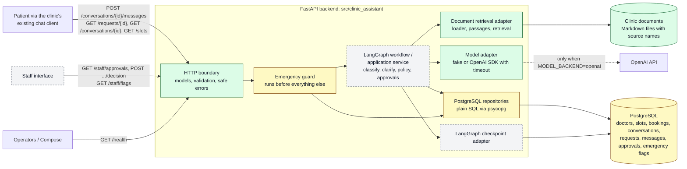

# System view

Status: **Proposed for [#50](https://github.com/LaAaG21/clinic-assistant/issues/50);
the linked designs are still under team review.** One picture of the parts and
who talks to whom. Details are not repeated here: the API is in the
[service boundaries and API contract](service-boundaries-and-api.md) (#6), the
tables in the [database diagram](database-diagram.md) (#22) and the message
routing in the [message and staff-approval workflow](message-workflow.md) (#38).

Green parts exist on `main`; yellow parts exist in part; dashed grey parts are
planned. As of 2026-11-05: the HTTP boundary has models (#8), safe errors (#43),
settings (#18) and `/health` (#14); the retrieval adapter has the loader (#21),
passages (#28) and retrieval (#41); the model adapter has the fake (#46) and the
OpenAI SDK implementation with timeout and failure mapping (#53, #58);
classification (#63) and clarification (#68) are pure functions waiting for the
workflow (#70). PostgreSQL holds `doctors`, `slots`, `bookings` and
`conversations` (#19, #39, #26); requests, messages and approvals are in review
or pending (#52, #26, #40). The emergency guard and staff flags (#55, #60), the
Docker packaging (#25), the production checkpointer (#51) and the message and
request endpoints (#75, #80) are in open PRs or still to do.

## Research and decisions

| Topic | Evidence | Decision status |
| --- | --- | --- |
| PostgreSQL checkpoints (#3) | [R1 note](../research/r1-postgres-checkpoints.md) | Proposed; saver mode and thread mapping open |
| Staff interrupt and resume (#4) | [Interrupt/resume note](../research/004-staff-interrupt-resume.md) | Proposed; runtime pause/resume evidence still to record |
| Clinic-document retrieval (#5) | [Retrieval comparison](../research/clinic-document-retrieval.md) | Proposed; method and limits open |
| Architecture decision records | [`docs/adr/`](../adr/README.md) | **No accepted ADR yet.** Record agreements there after the share-out; none is claimed here. |

## Learning question

*How do Ready and Done rules prevent a small task from becoming ambiguous?* A
Ready rule forces the question "what exactly will be true when this is done,
and what is out of scope?" to be answered before anyone starts, so the person
doing the task and the reviewer are checking the same list. A Done rule stops the
task from drifting: it is finished when that list is met and verified, not when
the author feels finished, and anything left over becomes a new, visible issue
instead of an unstated assumption. The rules are in the
[team working guide](../team/working-guide.md).
